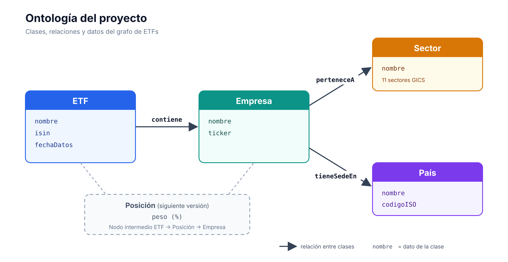

# Grafo de conocimiento de ETFs: IA semántica frente a LLM

Un grafo de conocimiento pequeño (3 ETFs, sus 10 principales posiciones, sus sectores y sus países) construido con RDF, OWL y SPARQL, y comparado con lo que responden dos modelos de lenguaje sin acceso a los datos.

La pregunta del proyecto: ¿qué gana un inversor si las respuestas salen de un grafo de conocimiento en lugar de la memoria de un LLM?

---

## ¿Qué es la IA neurosimbólica?

La IA neurosimbólica combina dos enfoques. La parte neuronal (los modelos de lenguaje como ChatGPT) aprende patrones estadísticos a partir de enormes cantidades de texto: maneja muy bien el lenguaje, pero responde por probabilidad y puede inventarse datos ("alucinar").

La parte simbólica representa el conocimiento de forma explícita en un grafo. Cada dato se guarda como una tripleta sujeto–predicado–objeto (por ejemplo, «MSCI World contiene Apple»), y al juntar muchas tripletas se forma una red de entidades conectadas. Una ontología define qué tipos de cosas existen y cómo se relacionan, lo que permite a la máquina deducir conocimiento nuevo. El grafo se consulta con el lenguaje SPARQL.

Al combinarlas, el modelo de lenguaje aporta la conversación y el grafo aporta los hechos: cada respuesta se puede verificar y rastrear hasta su fuente. Este proyecto construye la parte simbólica y mide qué ocurre cuando falta.

---

## La ontología



- 4 clases: ETF, Empresa, Sector y País.
- 3 relaciones: un ETF *contiene* empresas; una empresa *pertenece a* un sector y *tiene sede en* un país.
- Datos de trazabilidad: cada ETF guarda la fecha de sus datos y la URL de la que salen.

Decisiones de diseño

- Identificadores estables: ISIN para los ETFs, ticker para las empresas, código ISO de 2 letras para los países.
- Vocabularios estándar en lugar de inventados: los 11 sectores de la clasificación GICS.
- Sin pesos, de momento. El peso de una empresa dentro de un ETF no es un dato de la empresa ni del ETF, sino de la relación entre ambos. Guardarlo exige una clase intermedia (ETF → Posición → Empresa). Se deja para la siguiente versión, aunque el CSV ya recoge los pesos.

---

## Los datos

| ETF | ISIN | Fecha | Fuente |
|---|---|---|---|
| iShares Core MSCI World | IE00B4L5Y983 | 18-09-2026 | [stockanalysis.com](https://stockanalysis.com/quote/lon/SWDA/holdings/) |
| iShares Core S&P 500 | IE00B5BMR087 | 11-09-2026 | [stockanalysis.com](https://stockanalysis.com/quote/lon/CSP1/holdings/) |
| iShares Core MSCI Europe | IE00B4K48X80 | 30-09-2026 | [trackinsight.com](https://www.trackinsight.com/en/fund/SMEA/holdings) |

**Limpieza aplicada**

- Resolución de entidades: Alphabet aparece dos veces en los ETFs estadounidenses (acciones GOOGL y GOOG). Son la misma empresa, así que se fusionan en una sola sumando los pesos.
- Normalización: sectores con los nombres GICS exactos, países en código ISO, fechas en formato AAAA-MM-DD.

---

## Cómo funciona

```
posiciones.csv ──┐
                 ├──► cargar.py ──► grafo.ttl ──► consultas.py
ontologia.ttl ───┘
```

1. `ontologia.ttl` define las reglas: clases, relaciones y datos permitidos.
2. `cargar.py` lee `posiciones.csv`, crea las tripletas y guarda el grafo en `grafo.ttl`. Después usa el razonador como control de calidad: si una columna del CSV estuviera mal, deduciría que algo es a la vez, por ejemplo, Sector y País, y lo avisaría.
3. `consultas.py` responde 8 preguntas de inversor con SPARQL.

La máquina razona, no solo almacena. `razonar.py` muestra que, con solo decir «el MSCI World contiene Apple», el razonador deduce que Apple es una Empresa, porque la ontología establece que lo que contiene un ETF es una Empresa:

```
Empresas ANTES de razonar:
   (ningún resultado)

Empresas DESPUÉS de razonar:
   ex:AAPL
```

---

## Resultados

El grafo tiene 3 ETFs, 19 empresas, 8 sectores y 6 países.

- Diversificación aparente. El top 10 del MSCI World («global») y el del S&P 500 son las mismas 9 empresas, todas estadounidenses y con el mismo reparto sectorial. Tener los dos es comprar lo mismo dos veces.
- El que diversifica es el europeo. Aporta las 10 empresas no estadounidenses del grafo, de 5 países, y un peso mayor en Salud y Financiero.
- Concentración tecnológica. 5 de las 9 posiciones principales de los ETFs estadounidenses son de Tecnología de la Información.

Resultados completos en `resultados.txt`.

---

## Grafo frente a LLM

Las mismas 8 preguntas se hicieron a dos modelos de lenguaje respondiendo de memoria, sin acceso a los datos:

| | Correctas | Parciales | Incorrectas | Sin respuesta |
|---|---|---|---|---|
| Grafo | 8 | 0 | 0 | 0 |
| Claude Haiku | 1 | 2 | 4 | 1 |
| Claude Sonnet | 2 | 4 | 1 | 1 |

- Los errores del LLM son plausibles: incluye empresas que estuvieron en esos top 10 en el pasado (Berkshire, JPMorgan, Novo Nordisk). Recuerda una foto antigua y la presenta como actual.
- Un dato desactualizado contamina varias respuestas: ningún modelo sabe que Micron ha entrado en el top 10, y ese fallo arruina cuatro de las ocho respuestas.
- El LLM avisa de que puede estar desactualizado, pero no sabe decir en qué. El grafo responde con fecha y fuente exactas.

Análisis completo y respuestas literales de los modelos en [`comparacion.md`](comparacion.md).

---

## Limitaciones

- Los datos vienen de agregadores de terceros, con fechas distintas para cada ETF.
- El país asignado es el de la sede habitual de cada empresa; algunas fuentes usan el país de riesgo, que no siempre coincide.
- Solo se recogen las 10 principales posiciones, no la cartera completa.
- La comparación usa dos modelos de una misma empresa y una sola formulación de las preguntas.

## Siguientes pasos

- Clase Posición para guardar los pesos y responder «¿qué porcentaje de mi inversión está en tecnología?».
- Validación con SHACL en lugar del control de calidad casero.
- GraphRAG: conectar un LLM al grafo para que responda en lenguaje natural citando cada dato.
- Datos oficiales descargados directamente de iShares, con una misma fecha para los tres ETFs.

---

## Cómo ejecutarlo

```
pip install -r requirements.txt
python cargar.py       # genera grafo.ttl
python consultas.py    # responde las 8 preguntas
python razonar.py      # demostración del razonador
```

## Estructura

| Archivo | Contenido |
|---|---|
| `ontologia.ttl` | Ontología: clases, relaciones y datos |
| `ontologia.png` | Esquema de la ontología |
| `posiciones.csv` | Datos de origen, limpios |
| `cargar.py` | Construye el grafo y valida los datos |
| `grafo.ttl` | El grafo de conocimiento resultante |
| `consultas.py` | Las 8 consultas SPARQL |
| `resultados.txt` | Salida de las consultas |
| `razonar.py` | Demostración del razonamiento automático |
| `comparacion.md` | Comparación con los LLM |

---

Gonzalo Torrente Belío · Ingeniería Matemática e Inteligencia Artificial, Universidad Pontificia Comillas
